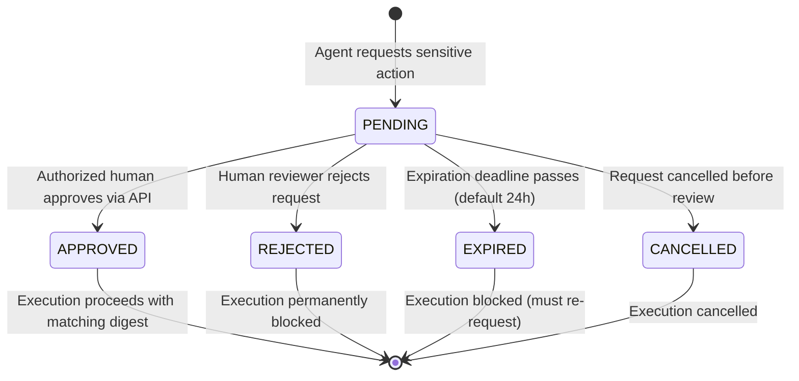

# CrewFlow Human Approval Workflow & Safety Gates

## 1. Overview

CrewFlow's Human Approval Workflow ensures that specialized AI agents can draft plans and generate code autonomously, but cannot deploy to production, push to remote repositories, modify secrets, or alter database schemas without explicit, verified human authorization.

---

## 2. Approval Lifecycle & State Transitions

Approvals follow a strictly enforced, concurrency-safe state machine:



### Valid Status Transitions
* `PENDING` → `APPROVED`
* `PENDING` → `REJECTED`
* `PENDING` → `EXPIRED`
* `PENDING` → `CANCELLED`

All transitions are atomic (`Prisma.$transaction`) using optimistic status guards (`where: { id, status: 'PENDING' }`). Two simultaneous reviewer decisions can never both succeed.

---

## 3. Cryptographic Action Digest & Tamper Prevention

Every approval request generates a canonical SHA-256 digest:
```ts
actionDigest = sha256(canonicalJson({
  category: action.category,
  type: action.type,
  target: action.target,
  command: action.command,
  payload: canonicalize(action.payload)
}))
```

### Guarantees
1. **Tamper Prevention**: If an agent requests approval for `npm test` but subsequently modifies the command to `npm test && rm -rf /`, the digest verification fails and throws `APPROVAL_DIGEST_MISMATCH`.
2. **Replay Prevention**: Approvals are bound to a single `executionId` and single `actionDigest`. An approval cannot be replayed for another task or execution.

---

## 4. Human Reviewer Authorization & Separation of Duties

### Identity Requirements
* Endpoints reject identity supplied via request body fields.
* The reviewer must authenticate via `x-user-id` header or `Authorization: Bearer <token>`.
* The reviewer must be an active member of the project's workspace.
* Critical actions (`L4` like production deployments) require workspace `ADMIN` or `OWNER` role.

### Separation of Duties
* When an action originated from a human user, that same user is prohibited from approving their own request.
* Throws `SELF_APPROVAL_PROHIBITED` (403).

---

## 5. Switch Notification Integration

Whenever approval events occur, `ApprovalNotifier` posts rich markdown notifications directly to the project's Switch room:

### Example: Approval Required
```markdown
🚨 **APPROVAL REQUIRED**
**Approval ID**: `cuid_12345678`
**Action**: deploy_production (DEPLOYMENT)
**Risk Level**: **L4**
**Requested By**: Agent `agent-dev`
**Reason**: Deployment or public release requires authorized human review.
**Status**: Pending human review
**Expires**: 2026-11-08T01:30:00.000Z

> *Note: Approval must be submitted via the authenticated CrewFlow API or dashboard.*
```

### Example: Approval Granted
```markdown
✅ **APPROVAL APPROVED**
**Approval ID**: `cuid_12345678`
**Action**: deploy_production
**Reviewed By**: `user_admin_99`
**Reason**: QA verified and staging smoke tests passed.
**Execution State**: Authorized to proceed
```

---

## 6. REST API Reference

### 1. List Approvals
* **Endpoint**: `GET /api/v1/approvals`
* **Query Parameters**:
  * `projectId` (optional): Filter by project.
  * `status` (optional): `PENDING`, `APPROVED`, `REJECTED`, `EXPIRED`, `CANCELLED`.
  * `riskLevel` (optional): `L0`..`L4`.
  * `limit` / `offset`: Pagination.
* **Response**: `200 OK`

### 2. Get Approval Details
* **Endpoint**: `GET /api/v1/approvals/:id`
* **Response**: `200 OK` with full payload and cryptographic digest.

### 3. Approve Action
* **Endpoint**: `POST /api/v1/approvals/:id/approve`
* **Headers**: `x-user-id: <user_id>` or `Authorization: Bearer <token>`
* **Body**:
  ```json
  {
    "decisionReason": "Reviewed staging tests and approved release"
  }
  ```
* **Response**: `200 OK`

### 4. Reject Action
* **Endpoint**: `POST /api/v1/approvals/:id/reject`
* **Headers**: `x-user-id: <user_id>`
* **Body**:
  ```json
  {
    "decisionReason": "Security vulnerabilities identified in dependencies"
  }
  ```
* **Response**: `200 OK`

### 5. Cancel Approval
* **Endpoint**: `POST /api/v1/approvals/:id/cancel`
* **Headers**: `x-user-id: <user_id>`
* **Body**:
  ```json
  {
    "decisionReason": "Task superseded by another request"
  }
  ```
* **Response**: `200 OK`

### 6. Query Security Audit Trail
* **Endpoint**: `GET /api/v1/security/audit`
* **Query Parameters**: `projectId`, `actorId`, `outcome`, `actionCategory`, `limit`, `offset`.
* **Response**: `200 OK` with sanitized, secret-scrubbed audit logs.
