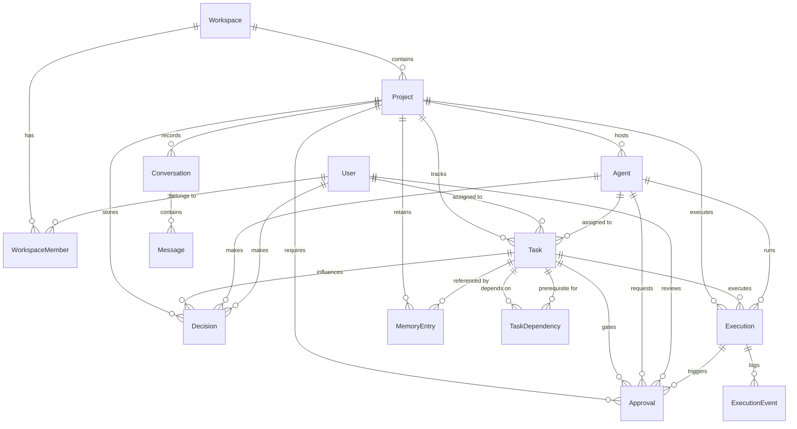

# CrewFlow Database Architecture & Data Models (Phase 2)

This document provides a comprehensive technical overview of the CrewFlow relational database architecture, entity relationships, integrity constraints, and deletion behaviors designed for PostgreSQL on Supabase.

---

## 1. High-Level Entity Relationship Diagram



---

## 2. Core Entities & Responsibilities

### 2.1 User and Workspace Management
- **`User`**: Represents human participants. Holds identity, name, email, and avatar.
- **`Workspace`**: Multi-tenant container for projects, settings, and teams. Slugs are URL-friendly and unique.
- **`WorkspaceMember`**: Explicit join entity between `User` and `Workspace` with roles:
  - `OWNER`: Full administrative control over the workspace, billing, and memberships.
  - `ADMIN`: Manages projects, members, and agent permissions.
  - `MEMBER`: Collaborates on tasks and projects.
  - *Unique Constraint*: A user can only have one membership record per workspace (`@@unique([workspaceId, userId])`).

### 2.2 Project Management
- **`Project`**: Core execution boundary. Isolates tasks, specialist agents, conversations, decisions, approvals, executions, and memory.
  - Statuses: `PLANNING`, `ACTIVE`, `PAUSED`, `COMPLETED`, `ARCHIVED`.

### 2.3 Task Management & Dependency DAG
- **`Task`**: Unit of work. Tracks status (`BACKLOG`, `TODO`, `IN_PROGRESS`, `IN_REVIEW`, `BLOCKED`, `COMPLETED`, `CANCELLED`) and priority (`LOW`, `MEDIUM`, `HIGH`, `CRITICAL`).
  - **Single Assignee Invariant**: A task can be assigned to a human (`assignedUserId`) OR an AI agent (`assignedAgentId`), but **never both simultaneously**. Enforced at database level (`CHECK`) and application layer (Zod refinement & validator).
- **`TaskDependency`**: Represents directed edges in the task dependency DAG (`taskId` depends on `dependsOnTaskId`).
  - **Self-Dependency Prohibition**: A task cannot depend on itself (`taskId != dependsOnTaskId`).
  - **Cross-Project Prohibition**: Dependencies between tasks in different projects are prohibited.
  - **Cycle Detection**: Multi-step circular dependencies (e.g., A → B → C → A) are detected using application-level Depth-First Search (`detectDependencyCycle`).

### 2.4 Agent Management
- **`Agent`**: Autonomous specialist AI agent provisioned within a project.
  - Roles: `COORDINATOR`, `DEVELOPER`, `QA`, `REVIEWER`.
  - Statuses: `ACTIVE`, `IDLE`, `BUSY`, `PAUSED`, `ERROR`, `OFFLINE`.
  - `capabilities` (JSONB): Structured array of actions the agent can perform.
  - `configuration` (JSONB): Tunables and operational parameters. **Strictly protected against storing secrets, tokens, or API keys**.

### 2.5 Conversation & Real-Time Sync
- **`Conversation`**: Contextual discussion threads within a project.
  - `externalRoomId`: Future mapping key to Switch collaboration rooms.
- **`Message`**: Discrete message entries with `senderType` (`HUMAN`, `AGENT`, `SYSTEM`) and `senderId`.

### 2.6 Project Decisions & Context
- **`Decision`**: Persistent record of architectural or operational choices made by humans or coordinator agents. Serves as reference context for future agent executions.

### 2.7 Human Approvals (Guarded Autonomy)
- **`Approval`**: Human-in-the-loop checkpoint gate. When an autonomous agent attempts a critical operation (e.g. schema migration, code deployment), an approval is generated.
  - Statuses: `PENDING`, `APPROVED`, `REJECTED`, `EXPIRED`, `CANCELLED`.
  - Audited with `reviewedByUserId` and `reviewedAt`.

### 2.8 Execution Tracking & Append-Only History
- **`Execution`**: Run record of an agent executing a task. Tracks input/output payloads, runtime errors, and start/completion timestamps.
  - Statuses: `QUEUED`, `RUNNING`, `SUCCEEDED`, `FAILED`, `CANCELLED`, `AWAITING_APPROVAL`.
- **`ExecutionEvent`**: Append-only log of granular lifecycle events within an execution (e.g. tool calls, subtask dispatch).

### 2.9 Persistent Memory & Shared Intelligence
- **`MemoryEntry`**: Long-term state retention.
  - Categories: `PROJECT_CONTEXT`, `USER_PREFERENCE`, `DECISION`, `TECHNICAL_KNOWLEDGE`, `TASK_CONTEXT`, `LESSON_LEARNED`.
  - Extensible foundation for future vector search / embedding retrieval.

---

## 3. Referential Actions & Deletion Behavior

| Parent Entity | Child Entity | Action | Rationale |
|---|---|---|---|
| `Workspace` | `WorkspaceMember` | `CASCADE` | Deleting a workspace removes membership associations. |
| `Workspace` | `Project` | `CASCADE` | Deleting a workspace cleans up all child projects. |
| `User` | `WorkspaceMember` | `CASCADE` | User removal cleans up memberships. |
| `User` | `Task` (`assignedUserId`) | `SET NULL` | Deleting a user unassigns tasks without deleting the task. |
| `User` | `Approval` (`reviewedByUserId`) | `SET NULL` | Historical approval records remain intact for audit logs. |
| `Project` | `Task`, `Agent`, `Conversation`, `Decision`, `Approval`, `Execution`, `MemoryEntry` | `CASCADE` | Deleting a project purges its operational data. |
| `Task` | `TaskDependency` | `CASCADE` | Dependencies are removed when a task is deleted. |
| `Task` | `Execution` | `CASCADE` | Task executions belong strictly to the task. |
| `Task` | `Approval`, `Decision`, `MemoryEntry` | `SET NULL` | Preserves audit trail even if task is deleted. |
| `Agent` | `Task` (`assignedAgentId`) | `SET NULL` | Tasks are unassigned if agent is deleted. |
| `Agent` | `Execution` | `RESTRICT` | Prevents deleting an agent that has existing execution history. |
| `Execution` | `ExecutionEvent` | `CASCADE` | Events are strictly tied to their execution run. |
| `Conversation` | `Message` | `CASCADE` | Messages are purged when conversation thread is deleted. |

---

## 4. Database Setup & Migrations

### 4.1 Connection Configuration
Supabase provides two connection URLs configured in `.env`:
1. `DATABASE_URL`: Connection pooler URL (Transaction Mode on port 6543) for runtime queries.
2. `DIRECT_URL`: Direct PostgreSQL connection URL (Session Mode on port 5432) for Prisma migrations and schema introspection.

### 4.2 Migration Execution
To apply migrations on Supabase:
```bash
npm run prisma:migrate
```

To regenerate the Prisma Client after schema changes:
```bash
npm run prisma:generate
```

---

## 5. Future Extension Points
1. **Switch Protocol**: `Conversation.externalRoomId` bridges Fastify to external Switch collaboration rooms.
2. **OpenCode Runtime**: `Execution` models map directly to isolated code execution sandboxes.
3. **Vector / Semantic Search**: `MemoryEntry` will receive `embedding vector(1536)` fields with `pgvector` index support in Phase 7.
