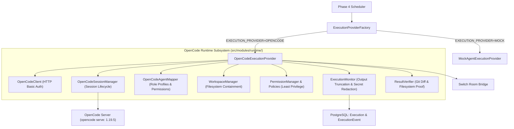

# CrewFlow — OpenCode Agent Runtime (Phase 5)

## 1. Overview

The **OpenCode Agent Runtime** module provides CrewFlow with the concrete execution environment for AI agents. It connects CrewFlow's orchestration interfaces (established in Phase 4) to real headless OpenCode servers (`opencode serve`, version `1.19.5`), managing authenticated connections, session lifecycles, project workspace containment, least-privilege permissions, execution monitoring, and tangible outcome verification.

---

## 2. Architecture & Component Interaction



---

## 3. OpenCode Server API Integration

The runtime integrates with the official OpenAPI 3.1 endpoints exposed by `opencode serve`:

| Operation ID | Endpoint | Description |
| :--- | :--- | :--- |
| `global.health` | `GET /global/health` | Probes server health and installed version (`{ healthy: true, version: "1.19.5" }`). |
| `session.create` | `POST /session` | Initializes an execution session with role permissions, model, and workspace context. |
| `session.get` | `GET /session/{id}` | Retrieves session status, active tasks, and execution state. |
| `session.prompt` | `POST /session/{id}/message` | Dispatches task instructions with parts, system prompt, and allowed tools. |
| `session.abort` | `POST /session/{id}/abort` | Aborts an in-flight execution when cancelled by an operator. |
| `session.diff` | `GET /session/{id}/diff` | Retrieves git diffs of files modified during the execution. |
| `session.delete` | `DELETE /session/{id}` | Gracefully closes and cleans up the session. |

---

## 4. Agent Role Mapping & Permission Rules

CrewFlow maps its logical agent roles to OpenCode agent profiles with role-specific system prompts, allowed tool flags, and least-privilege permission rules:

| Role | Allowed Tools | Permission Constraints | Primary Responsibility |
| :--- | :--- | :--- | :--- |
| **COORDINATOR** | `read: true`, `write: true`, `edit: true`, `bash: false` | Can edit `docs/*` and `*.md`. Denied bash execution. Denied `*.env*`. | System architecture, technical specifications, and cross-agent synthesis. |
| **DEVELOPER** | `read: true`, `write: true`, `edit: true`, `bash: true` | Allowed editing `src/*` and `prisma/*`. Allowed safe npm/npx commands. Denied `*.env*` and `rm -rf`. | Implementation code, database migrations, and structural refactoring. |
| **QA** | `read: true`, `write: true`, `edit: true`, `bash: true` | Allowed editing `tests/*`. Allowed `npm run test` and `npx vitest`. Denied `*.env*`. | Unit testing, regression suites, and bug reproduction. |
| **REVIEWER** | `read: true`, `write: false`, `edit: false`, `bash: true` | Read-only access. Allowed static analysis (`tsc`, `eslint`). Denied file edits. | Static analysis, code review, security audits, and quality assessment. |

---

## 5. Workspace Security & Containment

The `WorkspaceManager` and `WorkspaceSecurity` guard against unauthorized file system access:
- **Project Isolation**: Every project maps to a dedicated root: `<WORKSPACE_ROOT>/projects/<projectId>`.
- **Path Traversal Defense**: All file paths are validated to ensure they cannot escape the project root using relative sequences (`..`), null bytes (`\0`), or absolute root overrides.
- **Concurrent Write Locks**: A write lock mechanism prevents simultaneous conflicting agent executions from mutating the same project workspace concurrently.
- **Sensitive File Protection**: Protects `.env`, credentials, private keys, and secret configurations with default-deny rules.

---

## 6. Execution Monitoring & Evidence Verification

- **ExecutionMonitor**:
  - Sanitizes and redacts passwords, bearer tokens, API keys, and database connection strings.
  - Enforces output size limits (default: 64KB) to prevent database bloat from raw terminal logs.
  - Persists granular step events to `ExecutionEvent`.
- **ResultVerifier**:
  - **Never blindly trusts agent-generated text affirmations.**
  - Inspects `/session/{id}/diff` for real git diff modifications.
  - Verifies presence of expected target files on disk.
  - Evaluates test runner exit codes (must be `0`) and parses output logs for failure patterns.
  - Marks an execution `SUCCEEDED` only when physical evidence confirms completion.

---

## 7. Configuration Reference

```env
# Runtime Provider (MOCK or OPENCODE)
EXECUTION_PROVIDER=MOCK

# OpenCode Server HTTP API
OPENCODE_BASE_URL=http://127.0.0.1:4096
OPENCODE_SERVER_USERNAME=opencode
OPENCODE_SERVER_PASSWORD=
OPENCODE_TIMEOUT_MS=30000
OPENCODE_AUTO_APPROVE=false
OPENCODE_MAX_OUTPUT_BYTES=65536
WORKSPACE_ROOT_PATH=./workspaces
```

Switching between `MOCK` and `OPENCODE` is fully governed by `EXECUTION_PROVIDER`. If `OPENCODE` is selected and the server is unreachable, the execution safely fails with an `OpenCodeUnavailableError` without silently falling back to mock.
