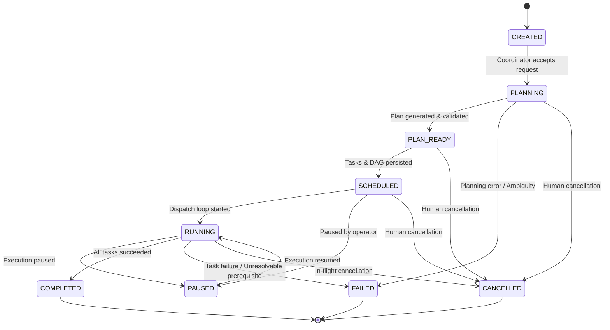
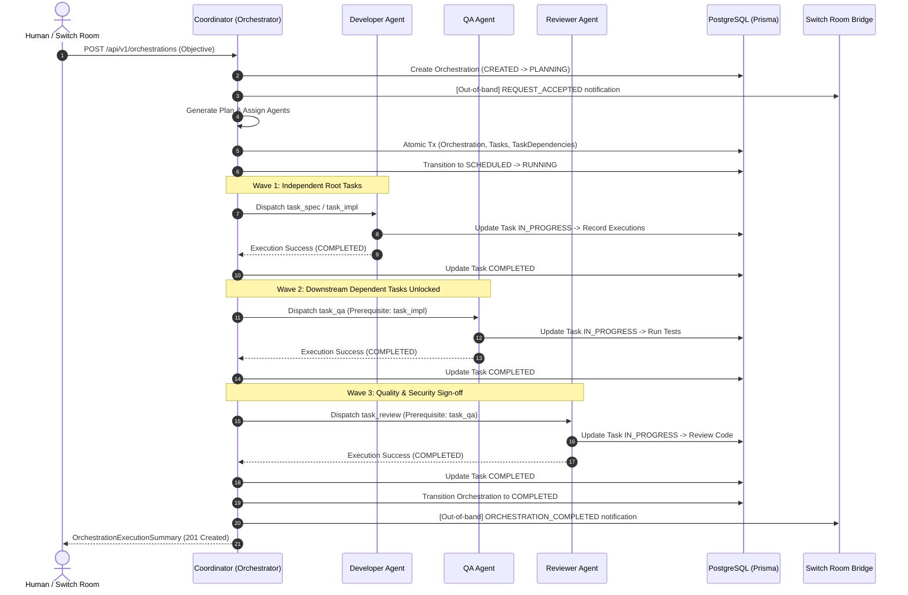

# CrewFlow — Agent Orchestration Engine (Phase 4)

## 1. Overview

The **Agent Orchestration Engine** is the central coordination intelligence of CrewFlow. It bridges human objectives submitted via Switch collaboration rooms or the REST API and coordinates specialized AI agents (Developer, QA, Reviewer, Coordinator) through a dependency-aware Directed Acyclic Graph (DAG) execution loop.

In accordance with strict architectural phasing:
- **Phase 4** establishes the planning, scheduling, state machines, capability matching, task handoffs, and execution dispatch contracts.
- **Phase 5** will implement the actual OpenCode runtime execution environments. The Phase 4 execution subsystem uses an extensible `AgentExecutionProvider` abstraction alongside a deterministic `MockAgentExecutionProvider`.

---

## 2. Architecture & Components

```mermaid
flowchart TD
    HumanReq["Human Request (Switch Room / REST API)"] --> Coordinator["Coordinator Facade (Orchestrator)"]
    
    subgraph Planning ["1. Task Planning & Decomposition"]
        Coordinator --> PlannerService["PlannerService"]
        PlannerService --> AmbiguityDetector["Ambiguity & Intent Analyzer"]
        AmbiguityDetector --> Strategy["BaselinePlanningStrategy"]
        Strategy --> StructuredPlan["StructuredExecutionPlan (Zod)"]
    end

    subgraph Selection ["2. Agent Discovery & Scoring"]
        StructuredPlan --> AgentRegistry["AgentRegistry (DB Discovery)"]
        AgentRegistry --> AgentSelector["AgentSelector (Capability Matching)"]
        AgentSelector --> ScoredAssignment["Scored Assignments & Audit Trail"]
    end

    subgraph Scheduling ["3. Dependency DAG & Scheduler"]
        ScoredAssignment --> TaskPersistence["Atomic Transaction (Tasks + Deps)"]
        TaskPersistence --> DAG["DependencyGraph (3-Color DFS)"]
        DAG --> Tiers["Topological Execution Tiers"]
        Tiers --> TaskScheduler["TaskScheduler (Evaluation Loop)"]
    end

    subgraph Execution ["4. Multi-Step Execution Loop & Handoffs"]
        TaskScheduler --> Dispatcher["ExecutionDispatcher"]
        Dispatcher --> Provider["AgentExecutionProvider (MockProvider)"]
        Provider --> StepEvents["Execution & Step Audit Records"]
        StepEvents --> HandoffManager["ExecutionManager (Multi-Agent Handoff)"]
    end

    subgraph Notification ["5. Real-Time Switch Notification"]
        HandoffManager --> EventHandler["OrchestrationEventHandler"]
        EventHandler --> SwitchModule["Switch Module (Out-of-band Delivery)"]
    end
```



---

## 3. Core Modules & Responsibilities

| Module | Location | Primary Responsibility |
| :--- | :--- | :--- |
| **Orchestrator** | `src/modules/orchestration/core/orchestrator.ts` | Central facade coordinating planning, assignment, persistence, scheduling, and execution. |
| **PlannerService** | `src/modules/orchestration/planner/planner.service.ts` | Analyzes ambiguity and decomposes human requests into structured plans. |
| **AgentSelector** | `src/modules/orchestration/agents/agent-selector.ts` | Capability-based scoring engine with workload penalties and eligibility filters. |
| **AgentRegistry** | `src/modules/orchestration/agents/agent-registry.ts` | Discovers project agents and queries real active task workloads in PostgreSQL. |
| **DependencyGraph** | `src/modules/orchestration/scheduler/dependency-graph.ts` | Directed graph with 3-color DFS cycle detection and topological tier computation. |
| **TaskScheduler** | `src/modules/orchestration/scheduler/task-scheduler.ts` | Evaluates ready tasks, blocked tasks, and propagates prerequisite failures. |
| **StateMachine** | `src/modules/orchestration/state/state-machine.ts` | Strict lifecycle matrix enforcing valid orchestration transitions. |
| **ExecutionDispatcher** | `src/modules/orchestration/execution/execution-dispatcher.ts` | Dispatches tasks, records `Execution` entities, and stores execution events. |
| **ExecutionManager** | `src/modules/orchestration/execution/execution-manager.ts` | Orchestrates the multi-agent task handoff loop and dependency unlocking. |
| **EventHandler** | `src/modules/orchestration/events/orchestration-event-handler.ts` | Persists domain events and publishes notifications to linked Switch rooms. |

---

## 4. Lifecycle State Machine

Orchestrations strictly adhere to the following transition matrix:



Terminal states (`COMPLETED`, `FAILED`, `CANCELLED`) cannot transition into any other state.

---

## 5. Agent Capability Matching & Scoring Algorithm

The `AgentSelector` evaluates candidates using an explainable formula ($0 - 100$ points):

1. **Hard Eligibility Filters**:
   - **Cross-Project Exclusion**: Agents belonging to another `projectId` score `0` and are ineligible.
   - **Status Gating**: Agents in `OFFLINE`, `PAUSED`, or `ERROR` states score `0` and are ineligible.
   - **Busy Check**: Agents in `BUSY` state are rejected unless `policy.allowBusyAgents` is true.
2. **Capability Scoring (Up to 70 pts)**:
   - Proportional match: $\text{points} = \text{round}\left(\frac{\text{matched}}{\text{required}} \times 70\right)$.
3. **Role Alignment Bonus (+20 pts)**:
   - Exact match between suggested role (`DEVELOPER`, `QA`, `REVIEWER`, `COORDINATOR`) and agent role.
4. **Availability Bonus (+10 pts)**:
   - `IDLE` agents receive $+10$ points; `ACTIVE` agents receive $+5$ points.
5. **Workload Balancing Penalty (-5 pts / active task, max -25 pts)**:
   - Prevents hotspotting when multiple agents share identical capabilities.
6. **Tie-Breaking**:
   - In the event of identical final scores, the agent with fewer active tasks is prioritized.

---

## 6. Multi-Step Task Handoff Flow

When executing a feature development plan, the engine conducts autonomous agent handoffs:



If any task fails, dependent tasks are flagged with failed prerequisites, the execution halts safely, and the session transitions to `FAILED` with detailed diagnostics without false completions.

---

## 7. REST API Endpoints

### `POST /api/v1/orchestrations`
Initiate an agent orchestration run from a human request.

**Request Body**:
```json
{
  "projectId": "proj_clw1234567890",
  "objective": "Implement OAuth2 login and token refresh flow",
  "initiatorUserId": "user_clw1234567890",
  "conversationId": "conv_clw1234567890",
  "context": {
    "framework": "Fastify",
    "provider": "Google"
  },
  "autoExecute": true
}
```

**Response (201 Created)**:
```json
{
  "success": true,
  "data": {
    "orchestrationId": "orch_9f4b3a12",
    "projectId": "proj_clw1234567890",
    "status": "COMPLETED",
    "objective": "Implement OAuth2 login and token refresh flow",
    "persistedTaskIds": ["task_dev_1", "task_qa_1", "task_rev_1"],
    "assignments": [
      {
        "taskId": "task_dev_1",
        "agentId": "agent_dev_01",
        "agentName": "Primary Backend Developer",
        "role": "DEVELOPER",
        "matchScore": 95,
        "reason": "Matched 4/4 capabilities. Role perfectly aligns. Agent is IDLE."
      }
    ],
    "scheduling": {
      "scheduledTaskIds": ["task_dev_1", "task_qa_1", "task_rev_1"],
      "blockedTaskIds": [],
      "completedTaskIds": ["task_dev_1", "task_qa_1", "task_rev_1"],
      "failedTaskIds": [],
      "inProgressTaskIds": []
    },
    "startedAt": "2026-11-06T23:55:00.000Z",
    "completedAt": "2026-11-06T23:55:05.000Z",
    "durationMs": 5120
  }
}
```

### `GET /api/v1/orchestrations/:id`
Retrieves orchestration session details, including current status, execution plan, and assigned tasks.

### `GET /api/v1/orchestrations/:id/events`
Returns the immutable chronological audit trail of orchestration and execution events.

### `POST /api/v1/orchestrations/:id/cancel`
Cancels an in-flight orchestration session and releases any reserved resources.

---

## 8. Database Schema Additions

Phase 4 introduces two core models and an enum in PostgreSQL via Prisma:

```prisma
enum OrchestrationStatus {
  CREATED
  PLANNING
  PLAN_READY
  SCHEDULED
  RUNNING
  PAUSED
  COMPLETED
  FAILED
  CANCELLED
}

model Orchestration {
  id              String              @id @default(uuid())
  projectId       String
  initiatorUserId String?
  conversationId  String?
  status          OrchestrationStatus @default(CREATED)
  objective       String
  context         Json                @default("{}")
  plan            Json?
  error           String?
  startedAt       DateTime?
  completedAt     DateTime?
  createdAt       DateTime            @default(now())
  updatedAt       DateTime            @updatedAt

  project         Project             @relation(fields: [projectId], references: [id], onDelete: Cascade)
  initiatorUser   User?               @relation("OrchestrationInitiator", fields: [initiatorUserId], references: [id], onDelete: SetNull)
  conversation    Conversation?       @relation(fields: [conversationId], references: [id], onDelete: SetNull)
  tasks           Task[]
  events          OrchestrationEvent[]

  @@index([projectId, status])
  @@index([status])
  @@index([conversationId])
  @@index([createdAt])
}

model OrchestrationEvent {
  id              String         @id @default(uuid())
  orchestrationId String
  eventType       String
  message         String
  payload         Json           @default("{}")
  createdAt       DateTime       @default(now())

  orchestration   Orchestration  @relation(fields: [orchestrationId], references: [id], onDelete: Cascade)

  @@index([orchestrationId, createdAt])
  @@index([eventType])
}
```

Furthermore, `Task` includes `orchestrationId` pointing to `Orchestration`, and `User` includes the relation `initiatedOrchestrations`.
