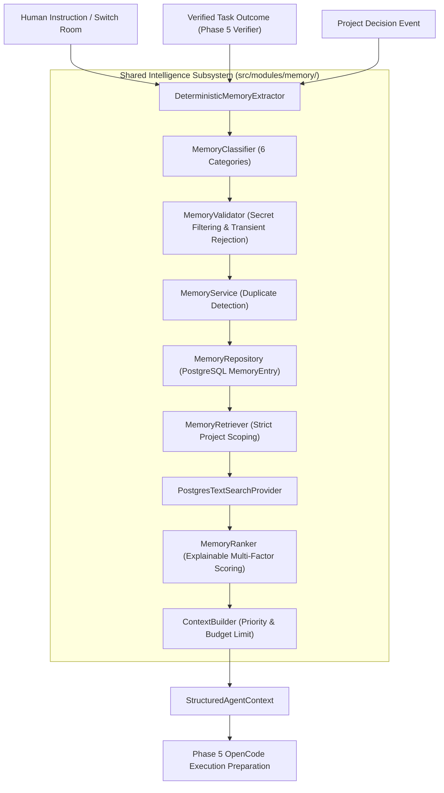

# CrewFlow — Shared Intelligence & Memory Engine (Phase 6)

## 1. Overview

The **Shared Intelligence and Memory Engine** gives CrewFlow persistent, context-aware memory across multi-agent workflows. It extracts verified technical decisions, architectural rules, and lessons learned from agent execution outcomes and human conversations, indexes them in PostgreSQL, and injects prioritized, bounded context into agent runtime prompts before task dispatch.

---

## 2. Architecture & Data Flow

---

## 3. Supported Memory Categories (`MemoryCategory`)

| Category | Description | Source Examples |
| :--- | :--- | :--- |
| `DECISION` | Architectural choices, selected frameworks, and design patterns. | Architecture documents, project decisions. |
| `TECHNICAL_KNOWLEDGE` | Database schema conventions, endpoint routes, protocol specifications. | Verified file modifications, API documentation. |
| `LESSON_LEARNED` | Pitfalls, bug fixes, edge case mitigations, regression warnings. | Post-task execution analysis, defect investigations. |
| `USER_PREFERENCE` | Team coding styles, formatting preferences, user instructions. | Human messages, project settings. |
| `TASK_CONTEXT` | Task requirements, acceptance criteria, milestone goals. | Task planning definitions. |
| `PROJECT_CONTEXT` | High-level project summaries, vision, workspace scope. | Project metadata. |

---

## 4. Extraction & Validation Lifecycle

- **Rejection of Transient Noise**: Rejects transient conversational messages (`"ok"`, `"thanks"`, `"looks good"`, `"test"`) and speculative claims (`"maybe we could"`).
- **Secret & Credential Redaction**: Automatically scrubs passwords, API keys, private keys, bearer tokens, and database connection strings before saving to memory.
- **Traceability**: Every record stores `projectId`, `taskId`, `sourceType`, `sourceId`, and confidence metrics.
- **Conflict Prevention**: `MemoryUpdater` prevents unverified notes from overwriting or downgrading established, verified architectural decisions.

---

## 5. Explainable Ranking Algorithm

The `MemoryRanker` scores candidate memories ($0 - 100$ points) based on five explainable dimensions:

1. **Keyword Relevance ($0 - 40$ pts)**: Proportional overlap with task keywords in title, content, and tags.
2. **Verification Status ($+25$ pts)**: Bonus for facts backed by verified execution evidence.
3. **Category Weight ($+15$ pts)**: Higher baseline weight for `DECISION` and `TECHNICAL_KNOWLEDGE`.
4. **Confidence Rating ($0 - 10$ pts)**: Scaled by confidence metric ($0.0 - 1.0$).
5. **Recency Decay ($0 - 10$ pts)**: Slight decay based on memory age to favor current project state.

---

## 6. Structured Agent Context Assembly

Before an agent executes a task, `ContextBuilder` constructs a `StructuredAgentContext` object:
1. **Project Summary & Core Architecture**
2. **Active Decisions**
3. **Technical Knowledge & Contracts**
4. **Task History & Acceptance Criteria**
5. **Lessons Learned & Pitfall Warnings**

### Quality Constraints:
- **Character Budget Limit**: Caps total injected context (default: 16,000 characters / ~4,000 tokens) to prevent context window overflow.
- **Fact vs. Note Distinction**: Clearly tags unverified notes separately from verified facts.
- **Project Isolation**: Guarantees zero cross-project memory leakage.

---

## 7. REST API Endpoints

| Method | Endpoint | Description |
| :--- | :--- | :--- |
| `POST` | `/api/v1/memory` | Stores a validated candidate memory with duplicate detection. |
| `GET` | `/api/v1/projects/:projectId/memory` | Retrieves and ranks memories for a project by keywords and category. |
| `GET` | `/api/v1/projects/:projectId/context` | Assembles a structured execution context payload for a given task. |
